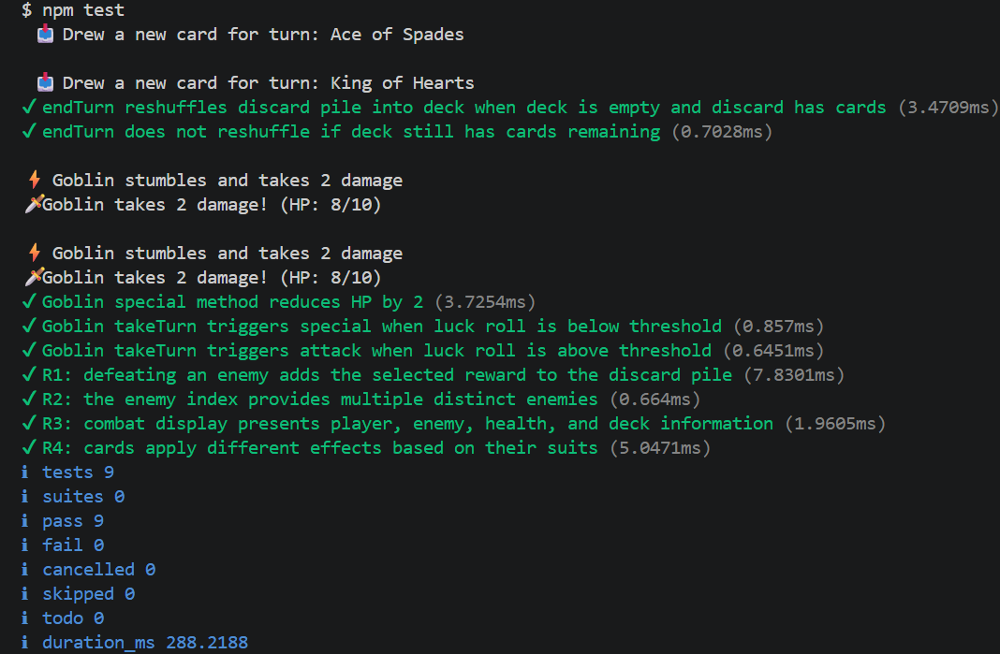

# Test Report

## Summary

The application was tested manually by going through the gameplay loop multiple times and confirming that the behaviour was as expected for various features such as rewards, statistics tracking, card playing etc.

Due to the random nature of the gameplay loop manual tests are hard to write for this application, as such I went with mostly automated unit tests which were written by AI. Dice-rng-toolkit does allow for seeded rng and if I had more time with the project implementing manual tests using the seeded rng feature is something I'd look into.

## Manual Test Results

| Test case                            | Requirement | Input                                                     | Expected outcome                                                   | Actual outcome                                                               |
| ------------------------------------ | ----------- | --------------------------------------------------------- | ------------------------------------------------------------------ | ---------------------------------------------------------------------------- |
| Show statistics such as hp, deck size and discard pile size   | R3          | "npm start"     | A box containing player and deck characteristics    | ✅ As expected.                                                              |   
| Application properly handles inputs and displays error messages   | R3          | "npm start" "9"     | An error message and no card being played   | ✅ As expected.                                                              |  
| Application properly handles inputs and displays error messages  | R3          | "npm start" "q"     | The application closes  | ✅ As expected.                                                              |  

## Automatic Test results

## Known Issues in Third-Party Modules

The installation instruction for dice-rng-toolkit was initially incorrectly written as the module was not published on npm. I submitted an issue to their Github repo and it was swiftly resolved. https://github.com/ThJoker3/Dice-RNG-Toolkit/issues/1
